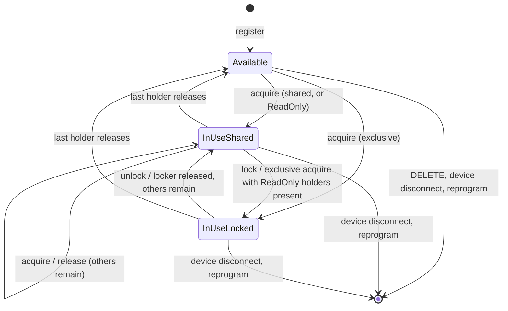

# ok-fpga-server Resource Management — Developer Guide (DRAFT rev 5)

> **Source of truth for this guide:** ADR-004, 005, 006, 015, 016, 017, 018,
> 020, 021, 023, 024, 025, 026, 029, **plus the owner decisions D1–D35 of
> 2026-10-10** (no source code, no other guides except the DualPort
> `axibridge-access-guide-v2.md` for §6). Where the OpenAPI spec disagrees,
> this is flagged (recommendations §3, S-items).
> **Status:** Draft for review, 2026-10-10.
> Markers: **⚠ Cn** = ADRs disagree; **❓ Nn** = open; **🟢 Dn** = owner
> decision beyond the current ADR text (the consolidated ADR will carry it,
> D32). All are tracked in
> [resource-management-recommendations.md](resource-management-recommendations.md).

---

## 1. Core idea

- A **resource** is a *named, user-defined capability* of a programmed FPGA,
  **not** the whole FPGA. One FPGA can expose many resources (ADR-006).
- Resources exist only while the FPGA is programmed (ADR-006).
- The **server is agnostic** to what a bitfile does and how it is used. The
  **entity that programs the FPGA defines and registers its resources**
  (ADR-020 §1, 🟢 D9). Designing resources is the job of the HDL designer
  and the software architect, within the rules in this guide. If a design
  needs protection the rules don't give by default, the architect chooses a
  stricter declaration (e.g. `exclusive`, `private`); the server does not
  guess (🟢 D21).
- One FPGA may be used by several users at once (ADR-006).

```
FPGA (serial ABC123, bitfile dsp_v2.bit)
 ├─ Resource "dac_ch1"     exclusive  holder: bob          (always locked)
 └─ Resource "adc_stream"  shared     holders: alice, carol (lockable)
```

### Precedence

| Topic | Original | Now governed by |
|---|---|---|
| Who creates resources | ADR-006 | ADR-020 §1 (client registers) |
| `access_mode` | ADR-006 (acquire) | ADR-020 §3: chosen at registration, **required** (🟢 D33) |
| Overlap between resources | ADR-020 §7–§8 | 🟢 D6, D8, D22 (first registration wins; shared-in-shared only) |
| Legacy resource (no `endpoints`) | ADR-020 §7 / ADR-024 §3 | 🟢 D15a, D23 (all classic EPs **exclusive**) |
| Disconnect | ADR-006 | ADR-020 §4 (deleted) |
| Reprogramming | ADR-006 | ADR-023 Fix-F, ADR-024 §10, 🟢 D15b, D26 |
| Runtime enforcement | ADR-020 §7.4/§8 | ADR-024; default `enforce`, all clients comply (🟢 D15e, D27) |
| Lock effect | ADR-020 §3 | ADR-024 §6; whole-resource blocking (🟢 D1, D5, D18, D19) |
| What counts as a read | ADR-024 §6, ADR-026 §1 | 🟢 D21: no state-change classification (❓N16 for Update\*Outs) |
| ReadOnly / Private | — | ADR-026; ADR-020 addendum 🟢 D15f, D25; `private` on EPs/ranges 🟢 D11 |
| Endpoint → address mapping | — | ADR-025 (DualPort-Transceiver stub, 🟢 D4) |
| Identity | ADR-020 §5, ADR-024 §1 | ADR-029 (implemented, 🟢 D15d) |

---

## 2. Defining a resource (registration)

`POST /api/v1/resources` / `DeviceService.CreateResource` → `201 Created`,
state `Available` (ADR-020 §1, §10–§11).

> [!WARNING]
> The OpenAPI `CreateResourceRequest` currently has only `name`,
> `description`, `device_serial`, `resource_type` and `capabilities`. The
> fields below come from ADR-020 §2. The spec must be brought in line
> (recommendations S1–S3; needs owner permission).

| Field | Required | Meaning | Source |
|---|---|---|---|
| `name` | ✅ | Unique per device | ADR-020 §2 |
| `description` | — | Free text | ADR-020 §2 |
| `device_serial` | ✅ | Device connected **and programmed** | ADR-020 §2, §10 |
| `access_mode` | ✅ | `shared` or `exclusive`. Missing → error that says so (🟢 D33) | ADR-020 §3 |
| `interfaces` | ✅ | `classic`, `axi_lite`, `axi_full`, `axi_stream` | ADR-020 §6 |
| `endpoints` | if classic | Classic EP declarations (§2.1) | ADR-020 §7 |
| `address_ranges` | — | Memory-mapped ranges (§2.2) | ADR-020 §8 |
| `metadata` | — | `map<string,string>` | ADR-020 §9 |
| `private` | — | L1: forbids ReadOnly acquisition | ADR-026 §2 |

### 2.1 Classic endpoint declarations

```json
"endpoints": {
  "default_access": "shared",
  "entries": [
    { "address": "0x00", "type": "wire_in",  "access": "shared" },
    { "address": "0x10", "type": "wire_in",  "access": "exclusive" },
    { "address": "0x20", "type": "wire_out", "access": "shared", "private": false }
  ]
}
```

- `type` must match the address block (WireIn 0x00–0x1F, WireOut 0x20–0x3F,
  TriggerIn 0x40–0x5F, TriggerOut 0x60–0x7F, PipeIn/BTPipeIn 0x80–0x9F,
  PipeOut/BTPipeOut 0xA0–0xBF).
- `default_access` applies to EPs not listed in `entries`.
- Per-EP `private` (L2) will be exposed in the API (🟢 D11).
- Per-EP `access: exclusive` inside a shared resource = **writable only by
  the locker** (🟢 D10). Other holders may still **read** it (D16, D21).

### 2.2 Address ranges

```json
"address_ranges": [
  { "start": "0x44A00000", "end": "0x44A00FFF", "access": "exclusive" },
  { "start": "0x80000000", "end": "0x9FFFFFFF", "access": "shared", "private": true }
]
```
32-bit, inclusive, `start ≤ end`. Per-range `private` (L3) will be exposed
(🟢 D11).

### 2.3 Registration rules (🟢 D6, D8, D22, D33)

**Rule A: exclusive resources contain only exclusive items.** A resource
with `access_mode: exclusive` that declares any shared EP, any shared range,
or `default_access: shared` is rejected (409).

**Rule B: first registration wins.** The first resource that declares an EP
or range defines it. A later registration is accepted only if every overlap
is **shared item in a shared resource, on both sides**, with the same type
and the same `private` flag. Otherwise the later registration is denied,
with an error that names the existing resource and the conflicting item.

| # | Registered **first** (resource A) | Registered **second** (resource B) | Outcome for B |
|---|---|---|---|
| 1 | shared resource, EP 0x00 `shared` | shared resource, EP 0x00 `shared` | ✅ 201: overlap allowed |
| 2 | shared resource, EP 0x00 `shared` | shared resource, EP 0x00 `exclusive` | ❌ 409: "EP 0x00 already declared shared by A" |
| 3 | shared resource, EP 0x00 `exclusive` | shared resource, EP 0x00 `shared` | ❌ 409: "EP 0x00 already declared exclusive by A" |
| 4 | shared resource, EP 0x00 `exclusive` | shared resource, EP 0x00 `exclusive` | ❌ 409 |
| 5 | exclusive resource (EP 0x00, necessarily exclusive) | any resource declaring EP 0x00 | ❌ 409: "EP 0x00 belongs to exclusive resource A" |
| 6 | shared resource, EP 0x00 `shared` | **exclusive** resource declaring EP 0x00 | ❌ 409 (rule A and rule B) |
| 7 | — | exclusive resource with any shared item | ❌ 409 (rule A), whatever exists |
| 8 | shared, range 0x8000_0000–0x8FFF_FFFF `shared` | shared, range 0x8800_0000–0x9FFF_FFFF `shared` | ✅ 201: partial overlap of shared ranges allowed |
| 9 | shared, range X `shared` | any resource, overlapping range `exclusive` | ❌ 409 |
| 10 | any, range X `exclusive` | any overlapping range | ❌ 409 |
| 11 | shared, EP 0x20 `shared`, `private: false` | shared, EP 0x20 `shared`, `private: true` | ❌ 409: "private flag differs from A" (🟢 D22) |
| 12 | **legacy** classic resource (no `endpoints` → all classic EPs exclusive) | any classic resource | ❌ 409: legacy resource claims every EP (🟢 D23) |
| 13 | any | resource on the same device with the same `name` | ❌ 409 |
| 14 | — | any resource **without `access_mode`** | ❌ error: "access_mode is required (shared \| exclusive)" (🟢 D33) |

Order matters. Swapping rows 2 and 3 changes which registration fails, never
whether both can coexist.

### 2.4 Legacy resources (🟢 D15a, D23)

A classic resource with **no** `endpoints` field claims **every classic EP**
of the device as **exclusive**. Once one exists, no other classic resource
can be registered on that device. Use it only for a single-user bitfile.
(Whether it also claims address ranges: assumed **no**, ❓N19.)

### 2.5 Deleting a resource

`DELETE /resources/{id}` → `204`; `409` if anyone holds it (ADR-020 §10).
**Anyone** may delete (🟢 D15c) until RBAC exists (roadmap Future work, to be
widened, D31).

---

## 3. Access modes

| Concept | Values | Set when | Source |
|---|---|---|---|
| Resource `access_mode` | `shared`, `exclusive` | Registration (required) | ADR-020 §3, D33 |
| Holder mode | `Shared`, `Exclusive`, `ReadOnly` | Acquisition | ADR-026 §1, §3 |
| Item access | `shared`, `exclusive`, + `private` | Registration | ADR-020 §7–§8, ADR-026 §2, 🟢 D10/D11 |

- **Exclusive resource:** one read/write holder. Acquire → `InUseLocked`;
  always locked until release; `lock`/`unlock` return an error (ADR-020 §3).
  Contains only exclusive items (🟢 D6), so it never overlaps another
  resource.
- **Shared resource:** many holders (🟢 D3). Any non-ReadOnly holder may
  lock it. Several applications can hold one shared resource.
- **ReadOnly holder** (`mode: read_only`, ADR-026):
  - May **read** any non-private item the resource covers: output EPs
    (WireOut, TriggerOut, PipeOut, BTPipeOut) and direct FPGADataPortAXI /
    okRegisterBridge addresses (🟢 D16, D21).
  - May not: write any input EP or address, lock, or read private items.
  - **ReadOnly is denied ADR-025 developer-defined classic address ranges**
    (🟢 D12, D29). Reaching them needs input-EP writes (e.g. the DualPort
    bridge). A raw PipeOut/WireOut read is not ADR-025 mapped access, so it
    is allowed (unless private).
  - **Private** restricts ReadOnly only, at three levels (ADR-026 §2):
    L1 resource (ReadOnly acquire denied), L2 EP, L3 address range.
  - On an exclusive resource: allowed unless private (ADR-026 §4, 🟢 D15f,
    D25; states in §4.2).

---

## 4. Lifecycle operations

### 4.0 The lifecycle in one line (owner wording)

> **Acquire** (join the resource's set of **holders**) → **use** →
> **lock** (all of the resource's items are reserved for the ONE user
> `locked_by`) → **unlock** → **release** (leave the holders).

- You become a holder only by acquiring **that** resource, once (🟢 D2, D7).
- An exclusive resource is locked from acquire to release.
- A lock covers the **entire** resource, and makes every resource that
  shares an item with it **blocked** for its other holders (🟢 D5, §4.3).

### 4.1 States (ADR-006)

| State | Meaning |
|---|---|
| `Unavailable` / `Initializing` | Not programmed / being set up |
| `Available` | Registered, no holders |
| `InUseShared` | ≥1 holder, not locked (incl. only ReadOnly holders) |
| `InUseLocked` | Exclusive resource held, or shared resource locked |


"Blocked" (§4.3) is a **per-user condition**, not a state. The resource's
own state does not change when an overlapping resource is locked.

### 4.2 Acquire

`POST /resources/{id}/acquire` / `AcquireResource`.

| Resource state | Request | Result | Source |
|---|---|---|---|
| Available | per `access_mode` | ✅ | ADR-006, ADR-020 §3 |
| Available | read_only | ✅ unless private → `InUseShared` | ADR-026 §4, 🟢 D25 |
| InUseShared (shared resource) | shared | ✅ add holder | ADR-006 |
| InUseShared / InUseLocked | read_only | ✅ unless private | ADR-026 §4, 🟢 D15f |
| InUseShared, only ReadOnly holders (exclusive resource) | exclusive | ✅ → `InUseLocked`; ReadOnly holders stay | 🟢 D25 |
| InUseLocked (exclusive held) | exclusive | ❌ | ADR-006 |
| InUseLocked (shared, locked) | shared | ❌ ⚠ ADR-006 (ReadOnly only may join) | ADR-006 |
| any | caller already holds it, **same mode** | **200, idempotent**, no change | 🟢 D7 |
| any | caller already holds it, **different mode** | ❌ **409** (proposed, ❓N17): "already held as `shared`; release, then acquire as `read_only`" | 🟢 D28 |
| Unavailable / Initializing | any | ❌ | ADR-006 |

Acquiring a shared resource that is **blocked** succeeds. You become a
holder, but you cannot write until the blocking lock ends.

### 4.3 Lock, and blocking (🟢 D1, D5, D18, D19)

`POST /resources/{id}/lock` / `LockResource`.

- **Precondition:** caller holds the resource, not as ReadOnly.
- **Denied (409)** if the resource is already locked by someone else, **or**
  blocked for the caller. Try-lock only, no queue.
- **Effect:** `InUseShared → InUseLocked`, `locked_by` = caller. Holders
  stay holders and get `ResourceLocked`.

**Blocking rule.** Resource S is *blocked* for a user U when **another** user
V ≠ U holds the lock on a resource R that declares **at least one of the same
shared items** (EP or shared range) as S. A blocked resource is treated as
"locked by another user" **as a whole**:

- **no writes at all** through S, to any of S's items: shared EPs, exclusive
  EPs, ADR-025 ranges, direct AXI/okRegisterBridge ranges (🟢 D19);
- no `lock` on S;
- reads of non-private items through S stay allowed (🟢 D16, D21).

The locker is never blocked by her own lock. If Alice holds and locks
`port-a` and also holds `port-b`, `port-b` is **not** blocked for Alice
(🟢 D35, §6.2).

**Not transitive (🟢 D18).** Example: R = {A, B}, S = {B, C}, T = {C, D},
all shared. Alice locks R.

| Resource | Blocked for others? | Why |
|---|---|---|
| R | locked by Alice | — |
| S | **yes** | shares B with R |
| T | no | shares nothing with R |

Bob (holds S and T) can still write C through T, because C is not one of
R's items. He cannot write B (every resource that declares B is blocked) or
write anything through S.

**Write authorisation.** A write to item X is allowed if the user holds **at
least one** resource that covers X and is not ReadOnly, not locked by
another user, and not blocked. Then the exclusive-item and ADR-025 checks
apply (§5.3).

### 4.4 When to lock (🟢 D20)

- **Multi-step** operations on a shared resource (several calls that must
  not be interleaved) must be done under the lock.
- A **single-step** (atomic) write to a **shared** item needs no lock.
- Writes to **exclusive** items (per-EP exclusive D10, exclusive ranges
  ADR-025 §3) always need the lock on the resource that declares them, even
  single-step (proposed reading, ❓N18).
- Until server-side atomic transactions exist (future work), **every AXI
  bridge transaction is multi-step**: lock first.

### 4.5 Unlock

Only the locker. `InUseLocked → InUseShared`. Holders of the resource **and
of the resources it blocked** get `ResourceUnlocked`.

### 4.6 Release

The caller leaves the holder list; no holders left → `Available`. Release by
the locker while others remain → `InUseShared`. `POST /disconnect` releases
everything the user holds.

### 4.7 Heartbeat and auto-release (ADR-020 §5)

Any identified call refreshes `last_seen_at`. Send a heartbeat every
**≤ 24 s** while idle. After **60 s** of silence all the user's holds are
released (and their locks end).

### 4.8 Device events

| Event | Effect | Source |
|---|---|---|
| Device disconnected | All its resources deleted; holders notified | ADR-020 §4 |
| **Reprogrammed** by any user (REST or gRPC) | A forced override, atomic under the device lock: 1. all locks unlocked, 2. all holders released, 3. all resources deleted, 4. bitfile written. **Every holder of every resource on the device is informed, whatever its state** (locker, other holder, blocked, ReadOnly). Applies at every enforcement level; bypasses the "409 if held" delete rule. The programming client then registers new resources. | ADR-023 Fix-F, ADR-024 §10, 🟢 D15b, D26 |
| Who may program | Any connected user, until RBAC restricts it to authorised, authenticated users | ADR-024 §10, D26 |

---

## 5. Runtime enforcement

### 5.1 Levels (🟢 D15e, D27)

`[access_control] endpoint_enforcement = "off" | "warn" | "enforce"`.
Default **`enforce`**. **All clients must comply with `enforce`.** `off` and
`warn` exist only as **debugging aids**, to find a client that does not
follow the current rules. A user id is required in `warn`/`enforce`.
Denials: `403` problem+json / `PERMISSION_DENIED`; lock, acquire-mode and
registration conflicts: `409`.

### 5.2 Route tiers (ADR-024 §4)

| Tier | Routes | Check |
|---|---|---|
| 1 Management | `/server/*`, `/devices`, `/resources/*`, `/users/*`, `/events/*`, `/disconnect`, `/heartbeat` | user id |
| 2 Device | `/devices/{serial}`, `/configure`, `/settings/*`, `/sensors`, `/syzygy` | user id |
| 3 Data port | `/devices/{serial}/classic/**`, `/axi/**` | user id + holds a resource on the device + permission matrix |

### 5.3 Reads and writes, and the permission matrix (🟢 D16, D21)

There are only two classes. The server does **not** track whether an
operation changes hardware state.

| Class | Operations |
|---|---|
| **Read** | WireOut, TriggerOut, PipeOut, BTPipeOut; FPGADataPortAXI / okRegisterBridge reads. `UpdateWireOuts` / `UpdateTriggerOuts`: ❓N16 (proposed: read) |
| **Write** | WireIn, TriggerIn, PipeIn, BTPipeIn; FPGADataPortAXI / okRegisterBridge writes. An ADR-025 hook may map a classic write to an address, which is then checked |

U = requesting user; R = a resource U holds that covers the item. A write is
allowed if **at least one** such R allows it. "Usable" = not locked by
another user and not blocked (§4.3).

**Writes:**

| U's hold on R | Shared EP | Exclusive EP (D10) | Shared range (ADR-025 or direct) | Exclusive range (ADR-025 or direct) | Item **not** declared by R |
|---|---|---|---|---|---|
| none | ❌ | ❌ | ❌ | ❌ | ❌ |
| Shared holder, R usable, not locked | ✅ | ❌ | ✅ | ❌ | ❌ |
| Shared holder, R locked by U | ✅ | ✅ | ✅ | ✅ | ❌ |
| Shared holder, R locked by another user | ❌ | ❌ | ❌ | ❌ | ❌ |
| Shared holder, R **blocked** | ❌ | ❌ | ❌ | ❌ | ❌ |
| Exclusive holder (implicit lock) | — (D6) | ✅ | — (D6) | ✅ | ❌ |
| ReadOnly holder | ❌ | ❌ | ❌ | ❌ | ❌ |

`private` has no effect on writes (it only restricts ReadOnly, which cannot
write anyway).

**Reads:**

| U's hold on R | Read, non-private | Read, private | ADR-025 mapped access (needs writes) |
|---|---|---|---|
| none | ❌ | ❌ | ❌ |
| Shared / Exclusive holder, any lock state, incl. locked by another or blocked | ✅ | ✅ | follows the **write** table |
| ReadOnly holder | ✅ | ❌ | ❌ (D12, D29) |

### 5.4 When other users' reads could hurt you (🟢 D21)

The server allows reads by every holder, including reads that consume data
(PipeOut drains a FIFO) and reads during someone else's lock. **If a design
would be harmed by another holder's read, the architect must declare it
accordingly:**

- Put the item in an **exclusive** resource: only one read/write holder.
- Also mark it **`private`** (L1 resource, or L2 EP / L3 range) if ReadOnly
  observers must not read it either. ReadOnly may join an exclusive
  resource unless it is private (D15f).

Example: a capture engine streams results into a FIFO read through
PipeOut 0xA3. A second holder reading 0xA3 would steal samples. Declare
`capture` as an exclusive resource with 0xA3 `private: true`. A shared
`monitor` resource can still expose the status WireOuts to everyone.

Counter-example (DualPort, §6): the bridge's PipeOut 0xA0 must be shared by
both ports. Here protection comes from **client discipline**: a compliant
client only reads 0xA0 inside its own locked bridge transaction.

### 5.5 Pipeline for one data-port command

```
1. user identified?                                     (ADR-024 §1)
2. user holds ≥1 resource on the device?                 (ADR-024 §2.1)
3. candidates = held resources that cover the EP / address
     none → deny                                         (ADR-024 §2.3)
4. READ:  allow, unless the only candidates are ReadOnly holds and the
          item is private                                 (ADR-026, D16)
   WRITE: drop candidates that are ReadOnly, locked by another user,
          or blocked                                      (D5, D19)
          none left → deny 403
5. WRITE via a classic EP, on a remaining candidate R:
     ADR-025 hook: NoMapping / AllowAlways → continue
                   (AllowAlways skips only the address check, ❓G18)
                   MapsToAddress(a): a not in R's ranges → deny   (D9)
                                     shared range → continue
                                     exclusive range → need U's lock on R
     per-EP exclusive (D10) → need U's lock on R
6. WRITE via a direct address: same range checks as step 5
7. allow
```

- Checked **once per command**; transfers then run without per-byte checks
  (ADR-024 §5).
- The per-device FFI mutex (ADR-017/018) protects **single calls only**.
  Multi-step sequences need the resource lock (§4.4).
- ADR-025 hooks are **compiled Rust** (`ResourceAccessPolicy` trait in
  `ok-fpga-core`). Changing them requires recompiling the server.

---

## 6. Worked example: DualPort-Transceiver on an XEM8320 (🟢 D4, D9, D14, D30)

### 6.1 Setup (done by whoever programs the FPGA)

1. Program the XEM8320 with the DualPort-Transceiver bitfile. Any user may do this;
   it clears all existing resources (§4.8).
2. Register two **shared** resources (`access_mode` is required). Order does
   not matter: every overlap is shared-in-shared (§2.3 row 1).

| Resource | `access_mode` | Shared EPs (in both) | Exclusive ranges (own only) |
|---|---|---|---|
| `port-a` | shared | AXI bridge (WI 0x00–0x08, TI 0x40/0x44/0x45, WO 0x20–0x23/0x31, PipeIn 0x80, PipeOut 0xA0), Authenticator (WI 0x17, TI 0x4C, WO 0x2A–0x2C, TO 0x60–0x63), common GTY EPs | Core 0, Trigger 0, Gearbox 0, I2C 0, DDR4 lower half |
| `port-b` | shared | same | Core 1, Trigger 1, Gearbox 1, I2C 1, DDR4 upper half |

The bridge register map is `axibridge-access-guide-v2.md`. DualPort-Transceiver
uses **only three** bridge transactions (D30):

| Transaction | Calls (all on shared EPs) |
|---|---|
| One-shot write | WI 0x00 = address, WI 0x08 = data, UpdateWireIns, TI 0x45, UpdateWireOuts, check WO 0x20 (bresp) |
| Burst write | WI 0x00 = address, WI 0x02 = control, UpdateWireIns, PipeIn 0x80 data, TI 0x40, UpdateWireOuts, check WO 0x20 |
| Burst read (small mode) | WI 0x01 = address, WI 0x03 = control, UpdateWireIns, TI 0x44 bit 0, UpdateWireOuts, poll WO 0x21 bit 0, PipeOut 0xA0 |

Other bridge EPs: WO 0x22/0x23 = TX/RX timeout flags, WO 0x31 = read
counter, WI 0x05–0x07 = system / interconnect / FIFO resets. The port JSON
descriptions still disagree and must be fixed (recommendations S4).

**Module status** is read from AXI memory, not from WireOuts:
**Status Register 2** at module base + 0x08 (via a burst read):

| Bits | Core module | Trigger module |
|---|---|---|
| 7 | **Authenticated** | **Authenticated** |
| 4:1 | Current state | Current state |
| 0 | txTriggerArmed | txTriggerArmed |
| 8 | Core Ready | — |
| 9 / 10 | — | Trigger Armed / Triggered |
| 14:12 | txControlState | — |
| 31:16 | last_non_idle_address | — |

Status Register 3 (base + 0x0C) = the capture's final block address
pointer (Core).

### 6.2 Use

| Step | Who / what | Result |
|---|---|---|
| 1 | Alice acquires `port-a` | ✅ holder |
| 2 | Alice locks `port-a`, burst-reads Core 0 Status Register 2: bit 7 = 0 (not authenticated) | ✅. The read address is in `port-a`'s exclusive Core 0 range and Alice holds the lock |
| 3 | Still locked, Alice **authenticates** (WI 0x17, TI 0x4C, TO/WO …, per the authentication guide), re-reads bit 7 = 1, then unlocks | ✅. Authentication is multi-step on shared EPs, so it runs under the lock (N7). While Alice holds the lock, `port-b` is blocked for everyone else |
| 4 | Alice: lock `port-a` → one-shot write to Core 0 (0x44A0_0014) → unlock | ✅ (multi-step → lock, D20) |
| 5 | Bob acquires `port-b` | ✅, even while `port-a` is locked: acquiring is not blocked |
| 6 | Bob locks `port-b` | ✅ if `port-a` is unlocked. If Alice holds the lock right now → **409** (blocked). Bob waits for `ResourceUnlocked` and retries |
| 7 | Bob burst-reads **Core 1** Status Register 2 (his own range): bit 7 = 1, Core Ready = 1 | ✅. The FPGA is already authenticated, so Bob skips authentication and uses `port-b` (one-shot / burst transactions into his ranges), then unlocks |
| 8 | Alice (holds only `port-a`) sets WI 0x00 = a Core 1 address | ❌ 403: the address is not in any of `port-a`'s ranges (D9), locked or not |
| 9 | Bob writes WI 0x00 while Alice holds `port-a`'s lock | ❌ 403: `port-b` is blocked (D5, D19) |
| 10 | Bob reads WO 0x21 or PipeOut 0xA0 while Alice holds the lock | ✅ allowed by the server (D21). A **compliant** client never does this outside its own locked transaction: reading 0xA0 would steal Alice's burst-read data. This is the architect's accepted design (§5.4) |
| 11 | Carol acquires `port-a` as **ReadOnly** | ✅ unless private. She can read output EPs, but cannot use the bridge: ADR-025 ranges are denied to ReadOnly (D29). So she cannot read Status Register 2 |
| 12 | Bob writes WI 0x07 (FIFO reset) while nobody holds a lock | ✅. No server restriction (D17). Not disturbing other users is the clients' job |
| 13 | Someone reprograms the FPGA | Everything is cleared (§4.8). Alice, Bob and Carol are all informed and must start again at 6.1 |

**One user, both ports (🟢 D35).** Alice may acquire both `port-a` and
`port-b`. Neither is ever blocked for her by her own lock, so she may lock
either or both and write the exclusive ranges of the resources she holds.
To write `port-b`'s exclusive ranges, she needs the lock on **`port-b`**
under the rule in §4.4. Whether a lock on `port-a` alone should suffice is
❓N20.

### 6.3 Why the lock briefly blocks the other port

Both ports drive **one** physical bridge. Each transaction is 5–7 calls on
shared EPs, and interleaving corrupts both. Blocking `port-b` while
`port-a` is locked (D5) serialises the bridge, which is exactly what the
hardware needs. Future server-side declarative sequences (recommendations
§5) would make each transaction a single call.

---

## 7. Identity (ADR-029, implemented)

- REST: body `user_id`, then the `X-User-Id` header; they must match if both
  are present. Clients send both.
- gRPC: `user_id` field / `x-user-id` metadata.
- Future: mTLS / LDAP identity; RBAC (roadmap).

---

## 8. Client checklist

1. Program the FPGA if needed (this clears all resources on the device).
2. Register resources with an explicit `access_mode`. Expect `409` with a
   reason on any conflict (§2.3).
3. Acquire (repeat acquire in the same mode = 200; a different mode = 409:
   release first). Use `read_only` if you only read.
4. Lock → multi-step operation → unlock, for every bridge transaction and
   for authentication. `409` on lock = locked or blocked: wait for
   `ResourceUnlocked`, then retry. There is no queue.
5. Expect `403` on writes while your resource is locked by someone else or
   blocked.
6. Check device-level state (DualPort: Status Register 2 bit 7) before use.
7. Don't read shared FIFOs (e.g. PipeOut 0xA0) outside your own locked
   transaction.
8. Heartbeat ≤ 24 s while idle. Always send a user id (`enforce`).
9. Release when done. Handle `ResourceLocked`, `ResourceUnlocked`,
   `ResourceStateChanged`, including the reprogramming notifications.
