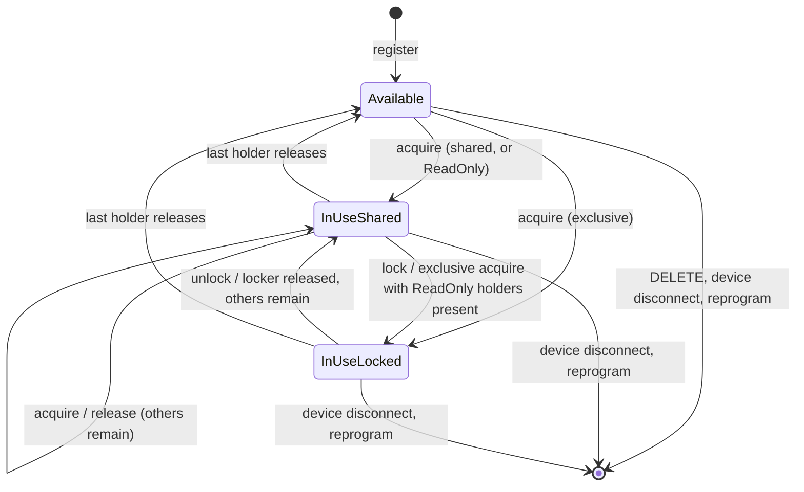

# ok-fpga-server Resource Management — Developer Guide (DRAFT rev 10)

> **Source of truth for this guide:** ADR-003, 004, 005, 006, 015, 016, 017,
> 018, 020, 021, 023, 024, 025, 026, 029, **plus the owner decisions D1–D77
> of 2026-10-10/11** (no source code, no other guides except the DualPort
> `axibridge-access-guide-v2.md` for §6). Where `api/openapi.yaml` or
> `proto/okfpga/v1/okfpga.proto` disagree, this is flagged (recommendations
> §3.3 S-items, §3.4 P-items).
> **Status:** Draft for review, 2026-10-10.
> Markers: **⚠ Cn** = ADRs disagree; **❓ Nn** = open; **🟢 Dn** = owner
> decision beyond the current ADR text (the consolidated ADR will carry it,
> D32). All are tracked in
> [resource-management-recommendations.md](resource-management-recommendations.md).

---

## 1. Core idea

- A **resource** is a *named, user-defined capability* of a programmed FPGA,
  **not** the whole FPGA. One FPGA can expose many resources (ADR-006).
- Resources exist only while the FPGA is programmed (ADR-006).
- The **server is agnostic** to what a bitfile does and how it is used. The
  **entity that programs the FPGA defines and registers its resources**
  (ADR-020 §1, 🟢 D9). Designing resources is the job of the HDL designer
  and the software architect, within the rules in this guide. If a design
  needs protection the rules don't give by default, the architect chooses a
  stricter declaration (e.g. an `exclusive` resource, `private`); the server
  does not guess (🟢 D21).
- The server enforces **who may write what**. It does **not** enforce
  transaction atomicity: serialising multi-step operations is the client's
  job, using the lock (🟢 D20, D46).
- One FPGA may be used by several users at once (ADR-006).

```
FPGA (serial ABC123, bitfile dsp_v2.bit)
 ├─ Resource "dac_ch1"     exclusive  holder: bob          (one holder only)
 └─ Resource "adc_stream"  shared     holders: alice, carol (lockable)
```

### Precedence

| Topic | Original | Now governed by |
|---|---|---|
| Who creates resources | ADR-006 | ADR-020 §1 (client registers) |
| `access_mode` | ADR-006 (acquire) | ADR-020 §3: chosen at registration, **required** (🟢 D33, D62), except a resource without `endpoints`, which is exclusive (🟢 D68, D77). Acquire `mode` optional (🟢 D62) |
| Overlap between resources | ADR-020 §7–§8 | 🟢 D6, D8, D22, D48 (shared items in shared resources **may overlap**; any other overlap → first registration wins) |
| Resource with no `endpoints` field | ADR-020 §7 / ADR-024 §3 ("legacy resource") | 🟢 D15a, D23, D68, D77: simply an **exclusive resource** claiming every **Wire and Trigger** EP (0x00–0x7F); Pipe/BTPipe EPs must be declared; no special name. Explicit empty `endpoints` = no EPs (🟢 D55) |
| `default_access` | ADR-020 §7, ADR-024 §2–§3 (covers unlisted EPs) | 🟢 D61: only the default `access` for listed entries |
| The word "legacy" | ADR-024 §3 (resource) | 🟢 D49: **only** the dataport `OK_DATAPORT_LEGACY` (ADR-003) |
| Meaning of an exclusive item | ADR-020 §7–§8, ADR-025 §3 (locker only) | 🟢 D44: writable by **holders** of the declaring resource; no lock required |
| When a lock is needed | ADR-020 §3, ADR-025 §3 | 🟢 D20, D46: never required by the server; client obligation for multi-step operations |
| Disconnect | ADR-006 | ADR-020 §4 (deleted) |
| Reprogramming | ADR-006 | ADR-023 Fix-F, ADR-024 §10, 🟢 D15b, D26 |
| Runtime enforcement | ADR-020 §7.4/§8 | ADR-024; default `enforce`, all clients comply (🟢 D15e, D27) |
| Lock effect | ADR-020 §3 | ADR-024 §6; whole-resource blocking of **writes** (🟢 D1, D5, D18, D19) |
| What counts as a read | ADR-024 §6, ADR-026 §1 | 🟢 D21, D42, D75: no state-change classification; `UpdateWireOuts` / `UpdateTriggerOuts` are reads |
| How reads work | — | 🟢 D76: exactly as Opal Kelly FrontPanel: Get/Is calls read the shared device snapshot; only Update calls touch the FPGA; optional `update` flag; one EP per read (no whole-bank reads) |
| ReadOnly / Private | — | ADR-026; ADR-020 addendum 🟢 D15f, D25; `private` on EPs/ranges 🟢 D11; ReadOnly rule 🟢 D75 |
| Endpoint → address mapping | — | ADR-025 (DualPort-Transceiver stub, 🟢 D4); §3 lock rule superseded by D44 |
| Identity | ADR-020 §5, ADR-024 §1 | ADR-029 (implemented, 🟢 D15d) |

---

## 2. Defining a resource (registration)

`POST /api/v1/resources` / `DeviceService.CreateResource` → `201 Created`,
state `Available` (ADR-020 §1, §10–§11).

> [!WARNING]
> Today `CreateResourceRequest` (OpenAPI and proto) has only `name`,
> `description`, `device_serial`, `resource_type` and `capabilities`. The
> owner has approved bringing both specs in line in Phase 44 (🟢 D36–D38):
> `resource_type` and `capabilities` are **removed**, and the fields below
> are added (recommendations S1–S3, P1–P14). Until then the specs remain
> authoritative.

| Field | Required | Meaning | Source |
|---|---|---|---|
| `name` | ✅ | Unique per device | ADR-020 §2 |
| `description` | — | Free text | ADR-020 §2 |
| `device_serial` | ✅ | Device connected **and programmed** | ADR-020 §2, §10 |
| `access_mode` | ✅ (— if `endpoints` omitted) | `shared` or `exclusive`. Missing → 422 that says so (🟢 D33, D38, D62). Exception: without `endpoints` it may be omitted and becomes `exclusive`; `shared` there → 422 (🟢 D68, D77). No "unspecified" value exists in either spec (🟢 D59) | ADR-020 §3 |
| `interfaces` | ✅ | `classic`, `axi_lite`, `axi_full`, `axi_stream`; may combine classic and AXI (🟢 D54) | ADR-020 §6 |
| `endpoints` | — | Classic EP declarations (§2.1). Omitted = exclusive resource claiming every Wire and Trigger EP, 0x00–0x7F (§2.4, 🟢 D77); `{"entries": []}` = no EPs (🟢 D55) | ADR-020 §7 |
| `address_ranges` | — | Memory-mapped ranges (§2.2) | ADR-020 §8 |
| `metadata` | — | `map<string,string>`: **text values only**. Put a list into one string, e.g. `"associated_cores": "Core_0,Trigger_0,Gearbox_0,axi_iic_0"`. Stored as-is, never interpreted, shown on the web dashboard (🟢 D69) | ADR-020 §9 |
| `private` | — | L1: forbids ReadOnly acquisition. Does **not** hide the resource from listings (🟢 D57). Recommended whenever a ReadOnly read could cause an unwanted side-effect (🟢 D75) | ADR-026 §2 |

**Words (🟢 D49, D50).**
- **Legacy** means only the FrontPanel dataport `OK_DATAPORT_LEGACY`
  (FP Gen1/Gen2 USB transport, ADR-003). **Every supported device reports
  it today.** A resource is never called "legacy".
- `OK_DATAPORT_UNKNOWN` is **not supported**: such a device is left out of
  device listings and treated as not present (404) (🟢 D70).
- **Classic** = FrontPanel classic EPs (WireIn/Out, TriggerIn/Out,
  Pipes). A Classic resource may also use **okRegisterBridge**
  (`ReadRegister` / `WriteRegister`) addresses, but **cannot** use direct
  AXI.
- **Direct AXI** = FPGADataPortAXI (AXI Lite / Full / Stream). It needs an
  `OK_DATAPORT_AXI` device: future boards, with new HDL, bitfiles and
  resources.

**Interfaces (🟢 D54).** One resource may list both `classic` and `axi_*`
interfaces (ADR-003). On an `OK_DATAPORT_LEGACY` device any `axi_*`
interface is rejected with 422 (ADR-020 §10), so **today every resource is
classic-only**. okRegisterBridge ranges need only `classic`.

### 2.1 Classic endpoint declarations

```json
"endpoints": {
  "default_access": "shared",
  "entries": [
    { "address": "0x00", "type": "wire_in",  "access": "shared" },
    { "address": "0x10", "type": "wire_in",  "access": "exclusive" },
    { "address": "0x20", "type": "wire_out", "access": "shared", "private": false }
  ]
}
```

- `type` must match the address block (WireIn 0x00–0x1F, WireOut 0x20–0x3F,
  TriggerIn 0x40–0x5F, TriggerOut 0x60–0x7F, PipeIn/BTPipeIn 0x80–0x9F,
  PipeOut/BTPipeOut 0xA0–0xBF).
- **A resource covers only the EPs listed in `entries`** (🟢 D61).
- `default_access` is only the `access` value used by listed entries that
  leave `access` out. It never claims unlisted EPs, and with an empty
  `entries` list it has no effect. An entry with neither `access` nor a
  `default_access` → 422. (ADR-020 §7 and ADR-024 §2–§3 said otherwise;
  superseded.)
- Per-EP `private` (L2) will be exposed in the API (🟢 D11).
- **`access: shared`** = other shared resources may also declare this EP.
- **`access: exclusive`** = **only this resource** may declare it, so only
  **holders of this resource** can write it (🟢 D44). It is **not** a mutex
  between those holders: every non-ReadOnly holder of the resource may write
  it, with no lock, unless the resource is locked by another user or
  blocked (§4.3). Other holders may always **read** it (D16, D21).

### 2.2 Address ranges

```json
"address_ranges": [
  { "name": "dac_ctrl", "start": "0x44A00000", "end": "0x44A00FFF", "access": "exclusive" },
  { "name": "shared_ddr", "start": "0x80000000", "end": "0x9FFFFFFF", "access": "shared", "private": true }
]
```
32-bit, inclusive, `start ≤ end`. `name` (optional) and per-range `private`
(L3) will be exposed (🟢 D11, D36). `access` has the same meaning as for EPs
(🟢 D44): an exclusive range belongs to this resource alone and is writable
by its holders without a lock. A range applies to ADR-025 mapped addresses,
okRegisterBridge addresses (classic) or direct AXI addresses (AXI
resources).

### 2.3 Registration rules (🟢 D6, D8, D22, D33, D48)

> [!IMPORTANT]
> Several resources **may** declare the same EP or overlapping ranges, as
> long as every overlap is a shared item in a shared resource on both sides
> (row 1, row 8). There is no "declare once" rule (🟢 D48).

**Rule A: exclusive resources contain only exclusive items.** A resource
with `access_mode: exclusive` that declares any shared EP, any shared range,
or `default_access: shared` is rejected with **422** (🟢 D72): the request
is invalid on its own, whatever else exists.

**Rule B: first registration wins.** The first resource that declares an EP
or range defines it. A later registration is accepted only if every overlap
is **shared item in a shared resource, on both sides**, with the same type
and the same `private` flag. Otherwise the later registration is denied,
with an error that names the existing resource and the conflicting item
(🟢 D38).

| # | Registered **first** (resource A) | Registered **second** (resource B) | Outcome for B |
|---|---|---|---|
| 1 | shared resource, EP 0x00 `shared` | shared resource, EP 0x00 `shared` | ✅ 201: overlap allowed |
| 2 | shared resource, EP 0x00 `shared` | shared resource, EP 0x00 `exclusive` | ❌ 409: "EP 0x00 already declared shared by A" |
| 3 | shared resource, EP 0x00 `exclusive` | shared resource, EP 0x00 `shared` | ❌ 409: "EP 0x00 already declared exclusive by A" |
| 4 | shared resource, EP 0x00 `exclusive` | shared resource, EP 0x00 `exclusive` | ❌ 409 |
| 5 | exclusive resource (EP 0x00, necessarily exclusive) | any resource declaring EP 0x00 | ❌ 409: "EP 0x00 belongs to exclusive resource A" |
| 6 | shared resource, EP 0x00 `shared` | **exclusive** resource declaring EP 0x00 | ❌ 422 (rule A, 🟢 D72) |
| 7 | — | exclusive resource with any shared item | ❌ 422 (rule A, 🟢 D72), whatever exists |
| 8 | shared, range 0x8000_0000–0x8FFF_FFFF `shared` | shared, range 0x8800_0000–0x9FFF_FFFF `shared` | ✅ 201: partial overlap of shared ranges allowed |
| 9 | shared, range X `shared` | any resource, overlapping range `exclusive` | ❌ 409 |
| 10 | any, range X `exclusive` | any overlapping range | ❌ 409 |
| 11 | shared, EP 0x20 `shared`, `private: false` | shared, EP 0x20 `shared`, `private: true` | ❌ 409: "private flag differs from A" (🟢 D22) |
| 12 | exclusive resource **without `endpoints`** (claims all Wire/Trigger EPs) | any resource that declares a classic EP | ❌ 409: A blocks later classic resources (🟢 D23, D68, D77) |
| 13 | any | resource on the same device with the same `name` | ❌ 409 |
| 14 | — | resource **with `endpoints` but without `access_mode`** | ❌ 422: "access_mode is required (shared \| exclusive)" (🟢 D33, D38, D62) |
| 14a | — | resource **without `endpoints`** and without `access_mode` | ✅ 201 as an exclusive resource claiming every Wire and Trigger EP (🟢 D68, D77) |
| 14b | — | resource **without `endpoints`** and `access_mode: shared` | ❌ 422: "a resource without endpoints is exclusive" (🟢 D68) |
| 14c | — | EP entry with no `access` and no `default_access` | ❌ 422 (🟢 D61) |
| 15 | — | resource on an `OK_DATAPORT_LEGACY` device (every device today) listing an `axi_*` interface, with or without `classic` | ❌ 422 (ADR-020 §10, 🟢 D54) |
| 16 | exclusive resource A without `endpoints` | resource with `"endpoints": {"entries": []}` and only register ranges that do not overlap A's ranges | ✅ 201: B claims no EPs (🟢 D55); A claims only its declared ranges (🟢 D52) |

Order matters. Swapping rows 2 and 3 changes which registration fails, never
whether both can coexist.

### 2.4 Omitted vs empty `endpoints` (🟢 D15a, D23, D52, D55, D61, D68, D77)

The `endpoints` field has three shapes:

| Shape | Meaning |
|---|---|
| `endpoints` **omitted** | A quick-and-dirty resource: it is simply an **exclusive resource** that claims **every Wire and Trigger EP** (0x00–0x7F) of the device (🟢 D77). Pipe / BTPipe EPs (0x80–0xBF) are **not** claimed: the server cannot tell a Pipe from a BTPipe at the same address, so pipes must always be declared explicitly. `access_mode` may be left out (it becomes `exclusive`); `exclusive` is accepted; `shared` → 422 (🟢 D68). Once one exists, no other resource that declares classic EPs can be registered on that device (row 12, D23). ReadOnly may join unless `private` (D25). Use it for a single-resource bitfile. |
| `"endpoints": {"entries": []}` | **No EPs.** Use this for a resource that only declares okRegisterBridge address ranges (row 16). |
| `"endpoints": {"entries": [ … ]}` | Exactly the listed EPs; `default_access` only fills in a missing `access` (🟢 D61). |

Quick-and-dirty example (every Wire and Trigger EP, exclusive; the
coverage change of D77 is implemented in 44-E):

```json
{ "name": "whole_design", "device_serial": "ABC123", "interfaces": ["classic"] }
```

In every shape a resource claims **only the address ranges it declares**
(🟢 D52). Example of a register-only resource:

```json
{
  "name": "dsp_regs",
  "device_serial": "ABC123",
  "access_mode": "exclusive",
  "interfaces": ["classic"],
  "endpoints": { "entries": [] },
  "address_ranges": [
    { "name": "dsp_ctrl", "start": "0x00001000", "end": "0x00001FFF", "access": "exclusive" }
  ]
}
```

(ADR-024 §3 calls the no-`endpoints` case a "legacy resource". "Legacy" is
reserved for `OK_DATAPORT_LEGACY` (🟢 D49); it is just an exclusive
resource (🟢 D68).)

### 2.5 Deleting a resource

`DELETE /resources/{id}` → `204`; `409` if anyone holds it (ADR-020 §10).
Reprogramming deletes held resources anyway (§4.8). **Anyone** may delete
(🟢 D15c) until RBAC exists (roadmap Future work, widened per D31).

---

## 3. Access modes

| Concept | Values | Set when | Source |
|---|---|---|---|
| Resource `access_mode` | `shared`, `exclusive` | Registration (required; `exclusive` when `endpoints` omitted) | ADR-020 §3, D33, D68, D77 |
| Holder mode | `Shared`, `Exclusive`, `ReadOnly` | Acquisition | ADR-026 §1, §3 |
| Item access | `shared`, `exclusive`, + `private` | Registration | ADR-020 §7–§8, ADR-026 §2, 🟢 D11, D44 |

- **Exclusive resource:** exactly one read/write holder. Acquire →
  `InUseLocked` (shown as "implicitly locked"); `lock`/`unlock` return an
  error (ADR-020 §3). Contains only exclusive items (🟢 D6), so it never
  overlaps another resource and is never blocked. This is the declaration
  to use when **one writer at a time** must be guaranteed by the server.
- **Shared resource:** many holders (🟢 D3). Every non-ReadOnly holder may
  write all of its items, shared or exclusive, without a lock (🟢 D44). Any
  non-ReadOnly holder may lock it to keep others out for a while.
- **ReadOnly holder** (`mode: read_only`, ADR-026, 🟢 D75):
  - May **read** any non-private item the resource covers: WireOuts and
    `UpdateWireOuts`; TriggerOuts (`IsTriggered`, `GetTriggerOutVector`,
    `UpdateTriggerOuts`); PipeOut / BTPipeOut; `ReadRegister(s)`; direct
    AXI reads (🟢 D16, D21, D42, D75).
  - May **never write**: no WireIn / `UpdateWireIns`, `ActivateTriggerIn`,
    PipeIn / BTPipeIn, register or AXI writes; no `ResetFPGA` (🟢 D75 F1;
    AXI resets count as writes); no lock; no reading of private items.
  - `UpdateTriggerOuts` (and `update=true` on a trigger read) is denied to
    ReadOnly when **any** resource on the device declares a `private`
    TriggerOut, because the call clears every TriggerOut latch of the
    device, including the private one (🟢 D75 F2).
  - **Design rule (recommended, not enforced, 🟢 D75):** a ReadOnly action
    should not change user-logic state or consume data that other holders
    rely on. In Opal Kelly HDL, `okWireOut` has no read strobe (a WireOut
    read is invisible to user logic), but `UpdateTriggerOuts` clears the
    TriggerOut latches, a PipeOut / BTPipeOut read drains a FIFO (`ep_read`),
    and an okRegisterBridge read pulses `ep_read`, which some designs use
    for clear-on-read registers. **Mark any such item `private`** if a
    ReadOnly read would be an unwanted side-effect. The HDL architect
    decides; the server does not guess (D21).
  - Optional server warning: with `warn_readonly_side_effects = true` in
    `config.toml`, the server logs a warning at registration when ReadOnly
    holders could reach a non-private PipeOut / BTPipeOut / TriggerOut or a
    non-private range (🟢 D75 F4, implemented in 44-E).
  - **ReadOnly is denied ADR-025 developer-defined classic address ranges**
    (🟢 D12, D29). Reaching them needs input-EP writes (e.g. the DualPort
    bridge). A raw PipeOut/WireOut read is not ADR-025 mapped access, so it
    is allowed (unless private).
  - **Private** restricts ReadOnly only, at three levels (ADR-026 §2):
    L1 resource (ReadOnly acquire denied), L2 EP, L3 address range.
  - On an exclusive resource: allowed unless private (ADR-026 §4, 🟢 D15f,
    D25; states in §4.2). ReadOnly holders never count against "exclusive".

---

## 4. Lifecycle operations

### 4.0 The lifecycle in one line (owner wording)

> **Acquire** (join the resource's set of **holders**) → **use** →
> **lock** (all of the resource's items are reserved for the ONE user
> `locked_by`) → **unlock** → **release** (leave the holders).

- You become a holder only by acquiring **that** resource, once (🟢 D2, D7).
- Holding is what grants write rights (🟢 D44). Locking only **takes them
  away from everyone else** for a while.
- A lock covers the **entire** resource, and makes every resource that
  shares an item with it **blocked** for its other holders (🟢 D5, §4.3).

### 4.1 States (ADR-006)

| State | Meaning |
|---|---|
| `Unavailable` / `Initializing` | Not programmed / being set up |
| `Available` | Registered, no holders |
| `InUseShared` | ≥1 holder, not locked (incl. only ReadOnly holders) |
| `InUseLocked` | Exclusive resource held, or shared resource locked |


"Blocked" (§4.3) is a **per-user condition**, not a state. The resource's
own state does not change when an overlapping resource is locked.

### 4.2 Acquire

`POST /resources/{id}/acquire` / `AcquireResource`.

The request `mode` is **optional** (🟢 D62). Omitted = the resource's
declared `access_mode`. `read_only` must be asked for. A `shared` or
`exclusive` request that differs from the declared mode → 409.

| Resource state | Request | Result | Source |
|---|---|---|---|
| Available | `mode` omitted, or equal to `access_mode` | ✅ | ADR-006, ADR-020 §3, 🟢 D62 |
| any | `shared` on an exclusive resource, or `exclusive` on a shared resource | ❌ 409: "resource is declared `exclusive`" | 🟢 D62 |
| Available | read_only | ✅ unless private → `InUseShared` | ADR-026 §4, 🟢 D25 |
| InUseShared (shared resource) | shared | ✅ add holder | ADR-006 |
| InUseShared / InUseLocked | read_only | ✅ unless private | ADR-026 §4, 🟢 D15f |
| InUseShared, only ReadOnly holders (exclusive resource) | exclusive | ✅ → `InUseLocked`; ReadOnly holders stay | 🟢 D25 |
| InUseLocked (exclusive held) | exclusive | ❌ | ADR-006 |
| InUseLocked (shared, locked) | shared | ❌ ⚠ ADR-006 (ReadOnly only may join) | ADR-006 |
| any | caller already holds it, **same mode** | **200, idempotent**, no change | 🟢 D7 |
| any | caller already holds it, **different mode** | ❌ **409**: "already held as `shared`; release, then acquire as `read_only`" | 🟢 D28, D43 |
| Unavailable / Initializing | any | ❌ | ADR-006 |

Acquiring a shared resource that is **blocked** succeeds. You become a
holder, but you cannot write until the blocking lock ends.

### 4.3 Lock, and blocking (🟢 D1, D5, D18, D19)

`POST /resources/{id}/lock` / `LockResource`.

- **Precondition:** caller holds the resource, not as ReadOnly.
- **Denied (409)** if the resource is already locked by someone else, **or**
  blocked for the caller. Try-lock only, no queue. The error names the
  locking resource and user (🟢 D38).
- **Effect:** `InUseShared → InUseLocked`, `locked_by` = caller. Holders
  stay holders and get `ResourceLocked`.

**Blocking rule.** Resource S is *blocked* for a user U when **another** user
V ≠ U holds the lock on a resource R that declares **at least one of the same
shared items** (EP or shared range) as S. A blocked resource is treated as
"locked by another user" **as a whole**:

- **no writes at all** through S, to any of S's items: shared EPs, exclusive
  EPs, ADR-025 ranges, okRegisterBridge / direct AXI ranges (🟢 D19).
  Blocking overrides the holder rights of D44;
- no `lock` on S;
- reads of non-private items through S stay allowed (🟢 D16, D21).

The locker is never blocked by her own lock. If Alice holds and locks
`port-a` and also holds `port-b`, `port-b` is **not** blocked for Alice
(🟢 D35, §6.2).

**Not transitive (🟢 D18).** Example: R = {A, B}, S = {B, C}, T = {C, D},
all shared. Alice locks R.

| Resource | Blocked for others? | Why |
|---|---|---|
| R | locked by Alice | — |
| S | **yes** | shares B with R |
| T | no | shares nothing with R |

Bob (holds S and T) can still write C through T, because C is not one of
R's items. He cannot write B (every resource that declares B is blocked) or
write anything through S.

**Write authorisation.** A write to item X is allowed if the user holds **at
least one** resource that covers X and is not ReadOnly, not locked by
another user, and not blocked. Then the ADR-025 address check applies
(§5.5). No lock is required (🟢 D44, D46).

**Each call is checked on its own**, against the lock state at that moment.
If Bob locks between two of Alice's unlocked calls, Alice's next write is
denied. That is why multi-step operations belong under the lock (§4.4).

### 4.4 When to lock (🟢 D20, D46)

The server **never requires** a lock to write. Locking is how a client
keeps other users out while it does something that must not be interleaved.

- **Multi-step** operations (several calls that must not be interleaved,
  writes **or reads**) on a resource that other users may hold: the client
  locks first, runs the steps, then unlocks. This is a **client
  obligation**; the server cannot tell that calls belong together.
- **Single-step** operations (one call) need no lock, on shared or
  exclusive items alike.
- **Single-user setups** (e.g. a single-resource bitfile, or an exclusive
  resource) need no lock at all; the server adds nothing.
- Until server-side atomic transactions exist (future work), **every AXI
  bridge transaction is multi-step**, so compliant clients lock around it.

### 4.5 Unlock

Only the locker. `InUseLocked → InUseShared`. Holders of the resource **and
of the resources it blocked** get `ResourceUnlocked`.

### 4.6 Release

The caller leaves the holder list; no holders left → `Available`. Release by
the locker while others remain → `InUseShared`. `POST /disconnect` releases
everything the user holds.

### 4.7 Heartbeat and auto-release (ADR-020 §5)

Any identified call refreshes `last_seen_at`. Send a heartbeat every
**≤ 24 s** while idle. After **60 s** of silence all the user's holds are
released (and their locks end).

### 4.8 Device events

| Event | Effect | Source |
|---|---|---|
| Device disconnected | All its resources deleted; holders notified | ADR-020 §4 |
| **Reprogrammed or cleared** by any user (REST or gRPC) | A forced override, atomic under the device lock: 1. all locks unlocked, 2. all holders released, 3. all resources deleted, 4. bitfile written (or configuration cleared). **Every holder of every resource on the device is informed, whatever its state** (locker, other holder, blocked, ReadOnly). Applies at every enforcement level; bypasses the "409 if held" delete rule. The programming client then registers new resources. | ADR-023 Fix-F, ADR-024 §10, 🟢 D15b, D26 |
| Who may program | Any connected user, until RBAC restricts it to authorised, authenticated users | ADR-024 §10, D26, D31 |
| `ResetFPGA` / `POST …/classic/reset` | **Not** a reprogram: resources stay. The tier-3 data-port gate (caller identified and holding any resource on the device, 🟢 D56, D66), and the caller must hold at least one resource on the device **not** as ReadOnly (🟢 D75 F1, enforced from 44-E). Future RBAC may restrict it | 🟢 D56, D66, D75 |

Approved events (🟢 D58), not yet in the specs: `ResourceLocked` and
`ResourceUnlocked` (`resource_id`, `user_id`), and a reason (`reprogram` /
`clear`) on `ResourceDeleted` (recommendations S5, P6).

---

## 5. Runtime enforcement

### 5.1 Levels (🟢 D15e, D27)

`[access_control] endpoint_enforcement = "off" | "warn" | "enforce"`.
Default **`enforce`**. **All clients must comply with `enforce`.** `off` and
`warn` exist only as **debugging aids**, to find a client that does not
follow the current rules. A user id is required in `warn`/`enforce`.
Denials: `403` problem+json / `PERMISSION_DENIED`; lock, acquire-mode and
registration conflicts with existing resources: `409`; anything wrong with
the request on its own: `422` (🟢 D38, D72).

### 5.2 Route tiers (ADR-024 §4)

| Tier | Routes | Check |
|---|---|---|
| 1 Management | `/server/*`, `/devices`, `/resources/*`, `/users/*`, `/events/*`, `/disconnect`, `/heartbeat` | user id |
| 2 Device | `/devices/{serial}`, `/configure`, `/settings/*`, `/sensors`, `/syzygy` | user id |
| 3 Data port | `/devices/{serial}/classic/**`, `/axi/**` | user id + holds a resource on the device + permission matrix |

### 5.3 Reads and writes, and the permission matrix (🟢 D16, D21, D42, D44, D75, D76)

There are only two classes. The server does **not** track whether an
operation changes hardware state.

| Class | Operations |
|---|---|
| **Read** | `UpdateWireOuts`, `GetWireOutValue`, `UpdateTriggerOuts`, `IsTriggered`, `GetTriggerOutVector`, PipeOut, BTPipeOut; `ReadRegister(s)` / direct AXI reads (🟢 D42, D75) |
| **Write** | WireIn (`SetWireInValue`, `UpdateWireIns`), `ActivateTriggerIn`, PipeIn, BTPipeIn; `WriteRegister(s)` / direct AXI writes; `ResetFPGA` and AXI resets (🟢 D75 F1). An ADR-025 hook may map a classic write to an address, which is then checked |

**How reads behave (🟢 D76, exactly as Opal Kelly FrontPanel).** The server
opens **one** FrontPanel handle per device, so every client shares the same
WireOut and TriggerOut **snapshot**:

- `UpdateWireOuts` / `UpdateTriggerOuts` are the only calls that talk to the
  FPGA. They copy the current WireOut values / TriggerOut latches into the
  snapshot. `UpdateTriggerOuts` also clears the latches on the FPGA.
- `GetWireOutValue`, `IsTriggered` and `GetTriggerOutVector` only read the
  snapshot left by the most recent Update call, **whoever made it**.
- The optional `update` flag (`?update=true` / proto `update = true`,
  default `false`) runs the Update call and the read together under the
  device lock, so no other client's Update can come in between.
- Every read names **one** endpoint. There are no whole-bank reads (a
  missing `endpoint` is a 422).

U = requesting user; R = a resource U holds that covers the item. A write is
allowed if **at least one** such R allows it. "Usable" = not locked by
another user and not blocked (§4.3).

**Writes:**

| U's hold on R | Shared EP | Exclusive EP | Shared range (ADR-025, register or AXI) | Exclusive range | Item **not** declared by R |
|---|---|---|---|---|---|
| none | ❌ | ❌ | ❌ | ❌ | ❌ |
| Shared holder, R usable (unlocked, or locked by U) | ✅ | ✅ | ✅ | ✅ | ❌ |
| Shared holder, R locked by another user | ❌ | ❌ | ❌ | ❌ | ❌ |
| Shared holder, R **blocked** | ❌ | ❌ | ❌ | ❌ | ❌ |
| Exclusive holder | — (D6) | ✅ | — (D6) | ✅ | ❌ |
| ReadOnly holder | ❌ | ❌ | ❌ | ❌ | ❌ |

- The only runtime difference between shared and exclusive items: a shared
  item may also be writable through **another** usable resource that
  declares it; an exclusive item only through its one resource (🟢 D44).
- **Exclusive item ≠ one writer.** Two holders of the same shared resource
  may both write its exclusive items. If only one writer may exist, use an
  **exclusive resource**, or have clients lock (§4.4).
- `private` has no effect on writes (it only restricts ReadOnly, which
  cannot write anyway).

**Reads:**

| U's hold on R | Read, non-private | Read, private | ADR-025 mapped access (needs writes) |
|---|---|---|---|
| none | ❌ | ❌ | ❌ |
| Shared / Exclusive holder, any lock state, incl. locked by another or blocked | ✅ | ✅ | follows the **write** table |
| ReadOnly holder | ✅ (🟢 D75; `UpdateTriggerOuts` / trigger `update=true` ❌ if any resource on the device declares a private TriggerOut) | ❌ | ❌ (D12, D29) |

### 5.4 When other users' reads could hurt you (🟢 D21)

The server allows reads by every holder, including reads that consume data
(PipeOut drains a FIFO) and reads during someone else's lock. **If a design
would be harmed by another holder's read, the architect must declare it
accordingly:**

- Put the item in an **exclusive** resource: only one read/write holder.
- Also mark it **`private`** (L1 resource, or L2 EP / L3 range) if ReadOnly
  observers must not read it either. ReadOnly may join an exclusive
  resource unless it is private (D15f).

Example: a capture engine streams results into a FIFO read through
PipeOut 0xA3. A second holder reading 0xA3 would steal samples. Declare
`capture` as an exclusive resource with 0xA3 `private: true`. A shared
`monitor` resource can still expose the status WireOuts to everyone.

**Triggers (🟢 D67 reopened, D75, D76).** `UpdateTriggerOuts` takes only the
device handle: it reads and clears the TriggerOut latches of the **whole
device**, and the result lands in the one shared snapshot. So one holder's
`UpdateTriggerOuts` can consume a trigger another holder was waiting for.

Example: an FPGA has two network ports. Alice uses `port-a` (TriggerOut
0x60), Bob uses `port-b` (TriggerOut 0x61). Bob's packet-arrived trigger
fires on 0x61. Before Bob polls, Alice calls `UpdateTriggerOuts` to check
0x60. The FPGA latch for 0x61 is now cleared, and the snapshot holds Bob's
trigger only until the next Update by anyone. If Bob then calls
`IsTriggered(0x61, update=true)`, he sees `false`: his trigger is lost.
Without `update`, Bob sees `true` only if nobody else ran an Update since
Alice did, and he has no way to know whether that is the case.

**Known limitation (🟢 D76, Q-G).** A client cannot tell whether other
clients ran `UpdateTriggerOuts` (or `UpdateWireOuts`) since its own last
read: it may see a snapshot made by someone else, and several updates may
have happened between two of its reads. This is standard FrontPanel
behaviour with one shared handle. Until the future TriggerOut event log
exists (roadmap 🔵 Later, D67 reopened), designs that cannot accept this
should:

- put the TriggerOuts in an **exclusive** resource and mark them
  **`private`** (once 44-E enforces D75 F2, this also stops ReadOnly
  holders from calling `UpdateTriggerOuts` on that device), or
- have clients read triggers only under the lock (§4.4), with all
  trigger users agreeing to that discipline, or
- signal events through WireOuts (status bits the user logic clears on a
  WireIn write) instead of TriggerOuts.

The server keeps **no** per-holder trigger copy.

Counter-example (DualPort, §6): the bridge's PipeOut 0xA0 must be shared by
both ports. Here protection comes from **client discipline**: a compliant
client only reads 0xA0 inside its own locked bridge transaction.

### 5.5 Pipeline for one data-port command

```
1. user identified?                                     (ADR-024 §1)
2. user holds ≥1 resource on the device?                 (ADR-024 §2.1)
3. candidates = held resources that cover the EP / address
     none → deny                                         (ADR-024 §2.3)
4. READ:  allow, unless the only candidates are ReadOnly holds and the
          item is private                                 (ADR-026, D16, D42)
          UpdateTriggerOuts / trigger update=true by a ReadOnly-only
          caller: deny if any resource on the device declares a private
          TriggerOut                                      (D75 F2, 44-E)
   WRITE: drop candidates that are ReadOnly, locked by another user,
          or blocked                                      (D5, D19)
          none left → deny 403
5. WRITE via a classic EP, on a remaining candidate R:
     ADR-025 hook: NoMapping / AllowAlways → allow
                   (AllowAlways skips only this address check, never
                    steps 1–4, 🟢 D51)
                   MapsToAddress(a): a in one of R's ranges → allow  (D44)
                                     otherwise → deny               (D9)
6. WRITE via okRegisterBridge / direct AXI address: a in one of R's
   ranges → allow, otherwise deny
7. ResetFPGA: no item; steps 1–2, and the caller must hold at least one
   resource on the device not as ReadOnly        (🟢 D56, D66, D75 F1, 44-E)
```

- R's ranges means the ranges of **the same** usable resource that passed
  step 4. A resource with no ranges cannot reach any address (D9), so a
  resource that only declares the bridge EPs never reaches another
  resource's ranges.

- Checked **once per command**; transfers then run without per-byte checks
  (ADR-024 §5).
- No step asks "does U hold the lock?" (🟢 D44, D46).
- The per-device FFI mutex (ADR-017/018) protects **single calls only**.
  Multi-step sequences need the client's lock (§4.4).
- ADR-025 hooks are **compiled Rust** (`ResourceAccessPolicy` trait in
  `ok-fpga-core`). Changing them requires recompiling the server.

---

## 6. Worked example: DualPort-Transceiver on an XEM8320 (🟢 D4, D9, D14, D30)

### 6.1 Setup (done by whoever programs the FPGA)

1. Program the XEM8320 with the DualPort-Transceiver bitfile. Any user may do this;
   it clears all existing resources (§4.8).
2. Register two **shared** resources (`access_mode` is required). Order does
   not matter: every overlap is shared-in-shared (§2.3 row 1).

| Resource | `access_mode` | Shared EPs (in both) | Exclusive ranges (own only) |
|---|---|---|---|
| `port-a` | shared | AXI bridge (WI 0x00–0x08, TI 0x40/0x44/0x45, WO 0x20–0x23/0x31, PipeIn 0x80, PipeOut 0xA0), Authenticator (WI 0x17, TI 0x4C, WO 0x2A–0x2C, TO 0x60–0x63), common GTY EPs | Core 0, Trigger 0, Gearbox 0, I2C 0, DDR4 lower half |
| `port-b` | shared | same | Core 1, Trigger 1, Gearbox 1, I2C 1, DDR4 upper half |

The bridge register map is `axibridge-access-guide-v2.md`. DualPort-Transceiver
uses **only three** bridge transactions (D30):

| Transaction | Calls (all on shared EPs) |
|---|---|
| One-shot write | WI 0x00 = address, WI 0x08 = data, UpdateWireIns, TI 0x45, UpdateWireOuts, check WO 0x20 (bresp) |
| Burst write | WI 0x00 = address, WI 0x02 = control, UpdateWireIns, PipeIn 0x80 data, TI 0x40, UpdateWireOuts, check WO 0x20 |
| Burst read (small mode) | WI 0x01 = address, WI 0x03 = control, UpdateWireIns, TI 0x44 bit 0, UpdateWireOuts, poll WO 0x21 bit 0, PipeOut 0xA0 |

Other bridge EPs: WO 0x22/0x23 = TX/RX timeout flags, WO 0x31 = read
counter, WI 0x05–0x07 = system / interconnect / FIFO resets. The port JSON
descriptions still disagree and are fixed in C-SFPP-1 (🟢 D39, S4).

**Module status** is read from AXI memory, not from WireOuts:
**Status Register 2** at module base + 0x08 (via a burst read):

| Bits | Core module | Trigger module |
|---|---|---|
| 7 | **Authenticated** | **Authenticated** |
| 4:1 | Current state | Current state |
| 0 | txTriggerArmed | txTriggerArmed |
| 8 | Core Ready | — |
| 9 / 10 | — | Trigger Armed / Triggered |
| 14:12 | txControlState | — |
| 31:16 | last_non_idle_address | — |

Status Register 3 (base + 0x0C) = the capture's final block address
pointer (Core).

### 6.2 Use

| Step | Who / what | Result |
|---|---|---|
| 1 | Alice acquires `port-a` | ✅ holder: she may now write `port-a`'s items |
| 2 | Alice locks `port-a`, burst-reads Core 0 Status Register 2: bit 7 = 0 (not authenticated) | ✅. The burst read is multi-step, so she locks (D20, D46). The address is in `port-a`'s Core 0 range |
| 3 | Still locked, Alice **authenticates** (WI 0x17, TI 0x4C, TO/WO …, per the authentication guide), re-reads bit 7 = 1, then unlocks | ✅. Multi-step on shared EPs, so under the lock (D24). While Alice holds the lock, `port-b` is blocked for everyone else |
| 4 | Alice: lock `port-a` → one-shot write to Core 0 (0x44A0_0014) → unlock | ✅. The server would accept the writes without the lock (D44), but the transaction is multi-step, so a compliant client locks |
| 5 | Bob acquires `port-b` | ✅, even while `port-a` is locked: acquiring is not blocked |
| 6 | Bob locks `port-b` | ✅ if `port-a` is unlocked. If Alice holds the lock right now → **409** (blocked). Bob waits for `ResourceUnlocked` and retries |
| 7 | Bob burst-reads **Core 1** Status Register 2 (his own range): bit 7 = 1, Core Ready = 1 | ✅. The FPGA is already authenticated, so Bob skips authentication and uses `port-b` (one-shot / burst transactions into his ranges), then unlocks |
| 8 | Alice (holds only `port-a`) sets WI 0x00 = a Core 1 address | ❌ 403: the address is not in any of `port-a`'s ranges (D9), locked or not |
| 9 | Bob writes WI 0x00 while Alice holds `port-a`'s lock | ❌ 403: `port-b` is blocked (D5, D19) |
| 10 | Bob reads WO 0x21 or PipeOut 0xA0 while Alice holds the lock | ✅ allowed by the server (D21). A **compliant** client never does this outside its own locked transaction: reading 0xA0 would steal Alice's burst-read data. This is the architect's accepted design (§5.4) |
| 11 | Carol acquires `port-a` as **ReadOnly** | ✅ unless private. She can read the non-private output EPs (WireOuts incl. UpdateWireOuts; TriggerOuts and PipeOuts unless private, D75), but cannot use the bridge: ADR-025 ranges are denied to ReadOnly (D29), and she may not write the bridge's WireIns / TriggerIns. So she cannot read Status Register 2. The architect should mark PipeOut 0xA0 `private`, since a ReadOnly read would steal bridge data (D75) |
| 12 | Bob writes WI 0x07 (FIFO reset) while nobody holds a lock | ✅. No server restriction (D17). Not disturbing other users is the clients' job |
| 13 | Dave also acquires `port-a` (shared). Alice and Dave both write Core 0 without locks | ✅ by the server (D44): both are holders. Their clients must coordinate with the lock, since the bridge is multi-step anyway |
| 14 | Someone reprograms the FPGA | Everything is cleared (§4.8). Everyone is informed and must start again at 6.1 |

**One user, both ports (🟢 D35, D46).** Alice may acquire both `port-a` and
`port-b`. Her own lock never blocks her, and she needs no lock to write the
exclusive ranges of either resource she holds. For a bridge transaction into
`port-b`'s ranges, locking **either** port is enough to keep other users
out, because a lock on one port blocks the other for everyone else.
Interleaving her **own** transactions is her client's concern; the server
does not protect a user from herself.

### 6.3 Why the lock briefly blocks the other port

Both ports drive **one** physical bridge. Each transaction is 5–7 calls on
shared EPs, and interleaving corrupts both. Blocking `port-b` while
`port-a` is locked (D5) serialises the bridge, which is exactly what the
hardware needs. Future server-side sequences (recommendations §5) would
make each transaction a single call.

---

## 7. Identity (ADR-029, implemented)

- REST: body `user_id`, then the `X-User-Id` header; they must match if both
  are present. Clients send both.
- gRPC: `user_id` field where the message has one, otherwise `x-user-id`
  metadata. Data-port and most management messages have **no** `user_id`
  field, and the proto does not yet document the metadata key
  (recommendations P8). gRPC clients must always send `x-user-id`.
- gRPC enums have **no** `UNSPECIFIED` value (🟢 D59). Where absence
  matters (registration and acquire mode), the proto will use `optional`
  fields so the server can tell "not sent" from the first enum value.
- Future: mTLS / LDAP identity; RBAC (roadmap, D31).

---

## 8. Client checklist

1. Program the FPGA if needed (this clears all resources on the device).
2. Register resources with an explicit `access_mode`, and an explicit
   `access` on every EP and range. Send `"endpoints": {"entries": []}`
   for a resource without EPs. Expect `409` (conflict) or `422`
   (validation) with a reason (§2.3).
3. Acquire (repeat acquire in the same mode = 200; a different mode = 409:
   release first). Use `read_only` if you only read. Holding is what lets
   you write.
4. Lock → multi-step operation → unlock, for every bridge transaction, every
   multi-step read, and authentication, whenever other users may hold an
   overlapping resource. `409` on lock = locked or blocked: wait for
   `ResourceUnlocked`, then retry. There is no queue. Single-step calls and
   single-user setups need no lock.
5. Expect `403` on writes while your resource is locked by someone else or
   blocked, even between two steps of an unlocked sequence.
6. Check device-level state (DualPort: Status Register 2 bit 7) before use.
7. Don't read shared FIFOs (e.g. PipeOut 0xA0) outside your own locked
   transaction.
8. Heartbeat ≤ 24 s while idle. Always send a user id (`X-User-Id` /
   `x-user-id`; `enforce`).
9. Release when done. Handle `ResourceLocked`, `ResourceUnlocked`,
   `ResourceStateChanged`, including the reprogramming notifications.
