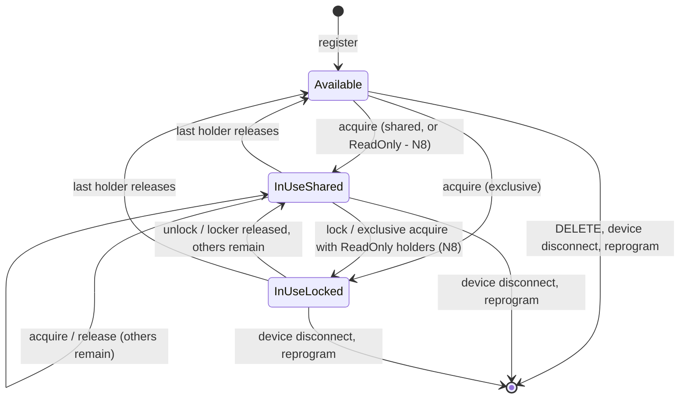

# ok-fpga-server Resource Management — Developer Guide (DRAFT rev 4)

> **Source of truth for this guide:** ADR-004, 005, 006, 015, 016, 017, 018,
> 020, 021, 023, 024, 025, 026, 029, **plus the owner decisions D1–D17 of
> 2026-10-10** (no source code, no OpenAPI/proto, no other guides except the
> DualPort `axibridge-access-guide.md` for §6).
> **Status:** Draft for review, 2026-10-10.
> Markers: **⚠ Cn** = ADRs disagree; **❓ Gn / Nn** = open gap; **🟢 Dn** =
> owner decision that goes beyond the current ADR text (the ADR still needs
> amending). All are tracked in
> [resource-management-recommendations.md](resource-management-recommendations.md).

---

## 1. Core idea

- A **resource** is a *named, user-defined capability* of a programmed FPGA,
  **not** the whole FPGA. One FPGA can expose many resources (ADR-006).
- Resources exist only while the FPGA is programmed (ADR-006).
- The **server is agnostic** to what a bitfile does. The **entity that
  programs the FPGA defines and registers its resources** (ADR-020 §1,
  🟢 D9). How resources are cut up is the job of the HDL designer and the
  software architect, within the rules in this guide. The server does not
  dictate how a resource's EPs or ranges are used.
- One FPGA may be used by several users at once (ADR-006).

```
FPGA (serial ABC123, bitfile dsp_v2.bit)
 ├─ Resource "dac_ch1"     exclusive  holder: bob          (always locked)
 └─ Resource "adc_stream"  shared     holders: alice, carol (lockable)
```

### Precedence

| Topic | Original | Now governed by |
|---|---|---|
| Who creates resources | ADR-006 | ADR-020 §1 (client registers) |
| Where `access_mode` is chosen | ADR-006 (acquire) | ADR-020 §3 (registration) |
| Overlap between resources | ADR-020 §7–§8 | 🟢 D6, D8 (first registration wins; shared-in-shared only) |
| Legacy resource (no `endpoints`) | ADR-020 §7 / ADR-024 §3 | 🟢 D15a (all EPs **exclusive**) |
| Disconnect | ADR-006 (→ `Unavailable`) | ADR-020 §4 (deleted) |
| Reprogramming | ADR-006 | ADR-023 Fix-F, ADR-024 §10, 🟢 D15b |
| Runtime enforcement | ADR-020 §7.4/§8 | ADR-024; default `enforce` 🟢 D15e |
| Lock effect | ADR-020 §3 | ADR-024 §6; whole-resource blocking 🟢 D1, D5 |
| ReadOnly / Private | — | ADR-026; ADR-020 addendum 🟢 D15f; `private` on EPs/ranges 🟢 D11 |
| Endpoint → address mapping | — | ADR-025 (DualPort-Transceiver stub, 🟢 D4) |
| Identity | ADR-020 §5, ADR-024 §1 | ADR-029 (implemented, 🟢 D15d; status still says Proposed) |

A consolidated ADR superseding the scattered sections is proposed
(recommendations §4).

---

## 2. Defining a resource (registration)

`POST /api/v1/resources` / `DeviceService.CreateResource` → `201 Created`,
state `Available` (ADR-020 §1, §10–§11).

| Field | Required | Meaning | Source |
|---|---|---|---|
| `name` | ✅ | Unique per device | ADR-020 §2 |
| `description` | — | Free text | ADR-020 §2 |
| `device_serial` | ✅ | Device connected **and programmed** | ADR-020 §2, §10 |
| `access_mode` | ✅ ⚠C1 | `shared` or `exclusive` | ADR-020 §3 |
| `interfaces` | ✅ | `classic`, `axi_lite`, `axi_full`, `axi_stream` | ADR-020 §6 |
| `endpoints` | if classic | Classic EP declarations (§2.1) | ADR-020 §7 |
| `address_ranges` | — | Memory-mapped ranges (§2.2) | ADR-020 §8 |
| `metadata` | — | `map<string,string>` | ADR-020 §9 |
| `private` | — | L1: forbids ReadOnly acquisition | ADR-026 §2 |

### 2.1 Classic endpoint declarations

```json
"endpoints": {
  "default_access": "shared",
  "entries": [
    { "address": "0x00", "type": "wire_in",  "access": "shared" },
    { "address": "0x10", "type": "wire_in",  "access": "exclusive" },
    { "address": "0x20", "type": "wire_out", "access": "shared", "private": false }
  ]
}
```

- `type` must match the address block (WireIn 0x00–0x1F, WireOut 0x20–0x3F,
  TriggerIn 0x40–0x5F, TriggerOut 0x60–0x7F, PipeIn/BTPipeIn 0x80–0x9F,
  PipeOut/BTPipeOut 0xA0–0xBF).
- `default_access` applies to EPs not listed in `entries`.
- Per-EP `private` (L2) will be exposed in the API (🟢 D11, spec change pending).
- Per-EP `access: exclusive` inside a shared resource = **writable only by
  the locker** (🟢 D10).

### 2.2 Address ranges

```json
"address_ranges": [
  { "start": "0x44A00000", "end": "0x44A00FFF", "access": "exclusive" },
  { "start": "0x80000000", "end": "0x9FFFFFFF", "access": "shared", "private": true }
]
```
32-bit, inclusive, `start ≤ end`. Per-range `private` (L3) will be exposed
(🟢 D11).

### 2.3 Registration rules (🟢 D6, D8)

**Rule A: exclusive resources contain only exclusive items.** A resource
with `access_mode: exclusive` that declares any shared EP, any shared range,
or `default_access: shared` is rejected (409).

**Rule B: first registration wins.** The first resource that declares an EP
or range defines it. A later registration is accepted only if every overlap
is **shared item in a shared resource, on both sides**, with the same type
and the same `private` flag (N5). Otherwise it is denied, with an error that
names the existing resource and the conflicting item.

| # | Registered **first** (resource A) | Registered **second** (resource B) | Outcome for B |
|---|---|---|---|
| 1 | shared resource, EP 0x00 `shared` | shared resource, EP 0x00 `shared` | ✅ 201: overlap allowed |
| 2 | shared resource, EP 0x00 `shared` | shared resource, EP 0x00 `exclusive` | ❌ 409: "EP 0x00 already declared shared by A" |
| 3 | shared resource, EP 0x00 `exclusive` | shared resource, EP 0x00 `shared` | ❌ 409: "EP 0x00 already declared exclusive by A" |
| 4 | shared resource, EP 0x00 `exclusive` | shared resource, EP 0x00 `exclusive` | ❌ 409 |
| 5 | exclusive resource (EP 0x00, necessarily exclusive) | any resource declaring EP 0x00 | ❌ 409: "EP 0x00 belongs to exclusive resource A" |
| 6 | shared resource, EP 0x00 `shared` | **exclusive** resource declaring EP 0x00 | ❌ 409 (rule A and rule B) |
| 7 | — | exclusive resource with any shared item | ❌ 409 (rule A), whatever exists |
| 8 | shared, range 0x8000_0000–0x8FFF_FFFF `shared` | shared, range 0x8800_0000–0x9FFF_FFFF `shared` | ✅ 201: partial overlap of shared ranges allowed |
| 9 | shared, range X `shared` | any resource, overlapping range `exclusive` | ❌ 409 |
| 10 | any, range X `exclusive` | any overlapping range | ❌ 409 |
| 11 | shared, EP 0x20 `shared`, `private: false` | shared, EP 0x20 `shared`, `private: true` | ❌ 409: private flags differ (N5, proposed) |
| 12 | **legacy** classic resource (no `endpoints` → all EPs exclusive) | any classic resource | ❌ 409: legacy resource claims every EP (N6) |
| 13 | any | resource on the same device with the same `name` | ❌ 409 |

Order matters. Swapping rows 2 and 3 changes which registration fails, never
whether both can coexist.

### 2.4 Legacy resources (🟢 D15a)

A classic resource with **no** `endpoints` field claims **every** EP of the
device as **exclusive**. Consequence (rule B, row 12): once one exists, no
other classic resource can be registered on that device. Use it only for a
single-user bitfile.

### 2.5 Deleting a resource

`DELETE /resources/{id}` → `204`; `409` if anyone holds it (ADR-020 §10).
**Anyone** may delete (🟢 D15c) until RBAC exists (roadmap Future work).

---

## 3. Access modes

| Concept | Values | Set when | Source |
|---|---|---|---|
| Resource `access_mode` | `shared`, `exclusive` | Registration | ADR-020 §3 |
| Holder mode | `Shared`, `Exclusive`, `ReadOnly` | Acquisition | ADR-026 §1, §3 |
| Item access | `shared`, `exclusive`, + `private` | Registration | ADR-020 §7–§8, ADR-026 §2, 🟢 D10/D11 |

- **Exclusive resource:** one read/write holder. Acquire → `InUseLocked`;
  always locked until release; `lock`/`unlock` return an error (ADR-020 §3).
  Contains only exclusive items (🟢 D6), so it never overlaps another
  resource.
- **Shared resource:** many holders (🟢 D3). Any non-ReadOnly holder may
  lock it. Several applications can hold one shared resource and control
  different parts of a design through shared EPs.
- **ReadOnly holder** (`mode: read_only`, ADR-026):
  - May: read cached WireOut/TriggerOut values; read **direct**
    FPGADataPortAXI and okRegisterBridge addresses — unless private.
  - May not: any write, any state-changing operation (§5.3), lock, or any
    private item.
  - **ReadOnly does not apply to ADR-025 developer-defined classic address
    ranges** (🟢 D12). Reaching them needs input-EP writes (e.g. the
    DualPort bridge), so a ReadOnly holder simply cannot use them.
  - **Private** restricts ReadOnly only, at three levels (ADR-026 §2):
    L1 resource (ReadOnly acquire denied), L2 EP, L3 address range.
  - On an exclusive resource: allowed unless private (ADR-026 §4; ADR-020
    addendum 🟢 D15f). Proposed states in §4.2 (N8).

---

## 4. Lifecycle operations

### 4.0 The lifecycle in one line (owner wording)

> **Acquire** (join the resource's set of **holders**) → **use** →
> **lock** (all of the resource's items are reserved for the ONE user
> `locked_by`) → **unlock** → **release** (leave the holders).

- You become a holder only by acquiring **that** resource, once (🟢 D2, D7).
- An exclusive resource is locked from acquire to release.
- A lock covers the **entire** resource. It also makes every resource that
  shares an item with it **blocked** for its other holders (🟢 D5, §4.3).

### 4.1 States (ADR-006)

| State | Meaning |
|---|---|
| `Unavailable` / `Initializing` | Not programmed / being set up |
| `Available` | Registered, no holders |
| `InUseShared` | ≥1 holder, not locked |
| `InUseLocked` | Exclusive resource held, or shared resource locked |


"Blocked" (§4.3) is a **per-user condition**, not a state. The resource's
own state does not change when an overlapping resource is locked.

### 4.2 Acquire

`POST /resources/{id}/acquire` / `AcquireResource`.

| Resource state | Request | Result | Source |
|---|---|---|---|
| Available | per `access_mode` | ✅ | ADR-006, ADR-020 §3 |
| Available | read_only | ✅ unless private → `InUseShared` (N8) | ADR-026 §4 |
| InUseShared (shared resource) | shared | ✅ add holder | ADR-006 |
| InUseShared / InUseLocked | read_only | ✅ unless private | ADR-026 §4, 🟢 D15f |
| InUseShared, only ReadOnly holders (exclusive resource) | exclusive | ✅ → `InUseLocked` (N8, proposed) | — |
| InUseLocked (exclusive held) | exclusive | ❌ | ADR-006 |
| InUseLocked (shared, locked) | shared | ❌ ⚠ (ADR-006 vs ADR-026 §4; ReadOnly only) | ADR-006 |
| any | caller already holds it | **200, idempotent**; holder mode unchanged (N11) | 🟢 D7 |
| Unavailable / Initializing | any | ❌ | ADR-006 |

Acquiring a shared resource that is **blocked** succeeds. You become a
holder, but you get no write rights until the blocking lock ends.

### 4.3 Lock, and blocking (🟢 D1, D5)

`POST /resources/{id}/lock` / `LockResource`.

- **Precondition:** caller holds the resource, not as ReadOnly.
- **Denied (409)** if the resource is already locked by someone else, **or**
  blocked for the caller (rule B3). Try-lock only, no queue.
- **Effect:** `InUseShared → InUseLocked`, `locked_by` = caller. Holders
  stay holders and get `ResourceLocked`.

**Blocking rule (B1).** Resource S is *blocked* for its holders (other than
V) when another user V holds the lock on a resource R that declares **at
least one of the same shared items** (EP or shared range) as S. A blocked
resource is treated as "locked by another user" **as a whole**:

- no writes through S, to **any** of S's items, including S's own exclusive
  ranges and direct AXI/okRegisterBridge paths to them (N2);
- no `lock` on S;
- reads of non-private items through S stay allowed (🟢 D16).

**Not transitive (B4, N1).** Example: R = {A, B}, S = {B, C}, T = {C, D},
all shared. Alice locks R.

| Resource | Blocked for others? | Why |
|---|---|---|
| R | locked by Alice | — |
| S | **yes** | shares B with R |
| T | no | shares nothing with R |

Bob (holds S and T) can still write C through T, because C is not one of
R's items. He cannot write B (every resource that declares B is blocked) or
use S at all.

**Write authorisation (B2).** A write to item X is allowed if the user holds
**at least one** resource that covers X and is not ReadOnly, not locked by
another user, and not blocked. The ADR-025 / D10 checks then apply (§5.4).

### 4.4 Unlock

Only the locker. `InUseLocked → InUseShared`; holders of the resource **and
of resources it blocked** get `ResourceUnlocked`.

### 4.5 Release

The caller leaves the holder list; no holders left → `Available`. Release by
the locker while others remain → `InUseShared` (❓G5). `POST /disconnect`
releases everything the user holds.

### 4.6 Heartbeat and auto-release (ADR-020 §5)

Any identified call refreshes `last_seen_at`. Send a heartbeat every
**≤ 24 s** while idle. After **60 s** of silence all the user's holds are
released (and their locks end).

### 4.7 Device events

| Event | Effect | Source |
|---|---|---|
| Device disconnected | All its resources deleted; holders notified | ADR-020 §4 |
| **Reprogrammed** by any user (REST or gRPC) | 1. all locks unlocked, 2. all holders released, 3. all resources deleted, 4. bitfile written. The programming client then registers new resources. Applies at every enforcement level; bypasses the "409 if held" delete rule; events for each step (N9) | ADR-023 Fix-F, ADR-024 §10, 🟢 D15b |
| Who may program | Any connected user, until RBAC | ADR-024 §10 |

---

## 5. Runtime enforcement

### 5.1 Levels

`[access_control] endpoint_enforcement = "off" | "warn" | "enforce"`.
Default **`enforce`** (🟢 D15e; ADR-024 §1 still says `off`; migration N10).
A user id is required in `warn`/`enforce`. Denials: `403` problem+json /
`PERMISSION_DENIED`; lock and registration conflicts: `409`.

### 5.2 Route tiers (ADR-024 §4)

| Tier | Routes | Check |
|---|---|---|
| 1 Management | `/server/*`, `/devices`, `/resources/*`, `/users/*`, `/events/*`, `/disconnect`, `/heartbeat` | user id |
| 2 Device | `/devices/{serial}`, `/configure`, `/settings/*`, `/sensors`, `/syzygy` | user id |
| 3 Data port | `/devices/{serial}/classic/**`, `/axi/**` | user id + holds a resource on the device + permission matrix |

### 5.3 Operation classes

| Class | Operations | Treated as |
|---|---|---|
| **Passive read** | Get cached WireOut value, cached TriggerOut / IsTriggered | read |
| **Direct address read** | FPGADataPortAXI read, okRegisterBridge read | read |
| **State-changing** | `UpdateWireOuts`, `UpdateTriggerOuts`, **PipeOut / BTPipeOut reads** (they drain FIFOs) | write-class (N4, proposed; ADR-024 §6 currently lists pipe reads as reads) |
| **Classic write** | WireIn (+ UpdateWireIns), TriggerIn, PipeIn, BTPipeIn | write |
| **Direct address write** | FPGADataPortAXI write, okRegisterBridge write | write |
| **ADR-025 mapped** | a classic write whose value the hook resolves to an address | write, then checked at the address |

### 5.4 Permission matrix

U = requesting user; R = a resource U holds that covers the item. For
writes, the result holds if **at least one** such R allows it (B2).
"Usable" = not locked by another user and not blocked (§4.3).

**Writes** (classic write, direct address write, state-changing op):

| U's hold on R | Shared EP | Exclusive EP (D10) | Shared range (ADR-025 or direct) | Exclusive range (ADR-025 or direct) | Range/EP **not** declared by R |
|---|---|---|---|---|---|
| none (no covering resource) | ❌ | ❌ | ❌ | ❌ | ❌ |
| Shared holder, R usable, not locked | ✅ | ❌ | ✅ | ❌ | ❌ |
| Shared holder, R locked by U | ✅ | ✅ | ✅ | ✅ | ❌ |
| Shared holder, R locked by another user | ❌ | ❌ | ❌ | ❌ | ❌ |
| Shared holder, R **blocked** | ❌ | ❌ | ❌ | ❌ | ❌ |
| Exclusive holder (implicit lock) | — (D6) | ✅ | — (D6) | ✅ | ❌ |
| ReadOnly holder | ❌ | ❌ | ❌ | ❌ | ❌ |

`private` has no effect on writes (it only restricts ReadOnly, which cannot
write anyway).

**Reads:**

| U's hold on R | Passive read, non-private | Passive read, private | Direct address read, non-private | Direct address read, private | ADR-025 mapped read (needs writes) |
|---|---|---|---|---|---|
| none | ❌ | ❌ | ❌ | ❌ | ❌ |
| Shared / Exclusive holder, any lock state, incl. blocked | ✅ (D16) | ✅ | ✅ | ✅ | follows the **write** table |
| ReadOnly holder | ✅ | ❌ | ✅ | ❌ | ❌ (D12) |

### 5.5 Pipeline for one data-port command

```
1. user identified?                                     (ADR-024 §1)
2. user holds ≥1 resource on the device?                 (ADR-024 §2.1)
3. classify the operation (§5.3)
4. candidates = held resources that cover the EP / address
     none → deny                                         (ADR-024 §2.3)
5. read class:   allow unless ReadOnly AND item private   (ADR-026, D16)
   write class:  drop candidates that are ReadOnly, locked by another
                 user, or blocked (B1)                    (D5)
                 none left → deny 403
6. ADR-025 hook for classic writes on a remaining candidate R:
     NoMapping / AllowAlways → allow (AllowAlways skips only the
                               address check, ❓G18)
     MapsToAddress(a): a not in R's ranges → deny        (D9)
                       shared range → allow
                       exclusive range → allow only if U holds R's lock
7. per-EP exclusive (D10): allow only if U holds R's lock
8. allow
```

- Checked **once per command**; transfers then run without per-byte checks
  (ADR-024 §5).
- The per-device FFI mutex (ADR-017/018) protects **single calls only**.
  Multi-call sequences need the resource lock.
- ADR-025 hooks are **compiled Rust** (`ResourceAccessPolicy` trait in
  `ok-fpga-core`). Changing them requires recompiling the server (N15).

---

## 6. Worked example: DualPort-Transceiver on an XEM8320 (🟢 D4, D9, D14)

### 6.1 Setup (done by whoever programs the FPGA)

1. Program the XEM8320 with the DualPort-Transceiver bitfile. Any user may do this;
   it clears all existing resources (§4.7).
2. Register two **shared** resources. Registration order does not matter
   here: every overlap is shared-in-shared (§2.3 row 1).

| Resource | `access_mode` | Shared EPs (in both) | Exclusive ranges (own only) |
|---|---|---|---|
| `port-a` | shared | AXI bridge (WI 0x00–0x08, TI 0x40/0x44/0x45, WO 0x20–0x23/0x31, Pipe 0x80/0xA0/0xA1), Authenticator (WI 0x17, TI 0x4C, WO 0x29–0x2C, TO 0x60–0x63), common GTY EPs | Core 0, Trigger 0, Gearbox 0, I2C 0, DDR4 lower half |
| `port-b` | shared | same | Core 1, Trigger 1, Gearbox 1, I2C 1, DDR4 upper half |

Bridge register roles (`axibridge-access-guide.md`): WI 0x00 = AXI write
address, WI 0x01 = AXI read address, WI 0x02/0x03 = write/read control,
WI 0x08 = OneShot write data, TI 0x45 = OneShot write, TI 0x40 = burst write,
TI 0x44 = burst read, PipeOut 0xA0 / BTPipeOut 0xA1 = read data,
WI 0x05–0x07 = resets. ⚠ Some WireOut roles disagree with the JSON
descriptions (recommendations N13).

### 6.2 Use

| Step | Who / what | Result |
|---|---|---|
| 1 | Alice acquires `port-a` | ✅ holder |
| 2 | Alice locks `port-a` and **authenticates** the FPGA (WI 0x17, TI 0x4C, poll WO/TO …), then unlocks | ✅. Authentication is multi-step on shared EPs, so it runs under the lock (N7). While locked, `port-b` is blocked for others. |
| 3 | Alice: lock `port-a` → WI 0x00 = 0x44A0_0014, WI 0x08 = data, TI 0x45, `UpdateWireOuts`, check WO 0x20 → unlock | ✅. The hook maps WI 0x00 to 0x44A0_0014, which is in `port-a`'s exclusive Core 0 range and Alice holds the lock (N3) |
| 4 | Bob acquires `port-b` | ✅ (even if `port-a` is locked right now: acquire is not blocked) |
| 5 | Bob checks authenticated status (`UpdateWireOuts`, read WO 0x29) | ✅ when `port-a` is unlocked. While Alice holds the lock, `UpdateWireOuts` is state-changing → 403; Bob waits for `ResourceUnlocked` and retries |
| 6 | Status says authenticated → Bob uses `port-b`: lock → bridge transaction into Core 1 → unlock | ✅. A `409` on lock means Alice's lock on `port-a` currently blocks him; retry after `ResourceUnlocked` |
| 7 | Alice (holds only `port-a`) sets WI 0x00 = a `port-b` Core 1 address | ❌ 403: address not in any of `port-a`'s ranges (D9), locked or not |
| 8 | Bob writes WI 0x00 while Alice holds `port-a`'s lock | ❌ 403: `port-b` is blocked (B1) |
| 9 | Bob reads a cached WO value while `port-a` is locked | ✅ passive read (D16) |
| 10 | Bob reads PipeOut 0xA0 while Alice's burst read is in progress | ❌ 403: pipe reads are state-changing (N4, proposed). Without this rule he would steal Alice's data |
| 11 | Carol acquires `port-a` as **ReadOnly** | ✅ unless private. She can read cached EP values, but cannot use the bridge: ADR-025 ranges are not ReadOnly-capable (D12) |
| 12 | Bob writes WI 0x07 (FIFO reset) while nobody holds a lock | ✅. No server restriction (D17). Not resetting other users' transactions is the clients' job |
| 13 | Someone reprograms the FPGA | All locks, holds and resources are cleared (§4.7). Alice and Bob get events and must start again at 6.1 |

If Alice acquires **both** ports, she may also lock `port-b` and write its
ranges: ownership follows the acquisition, not the person (D9; to be
confirmed, recommendations Q16). Keeping one application per port is the client
architect's choice.

### 6.3 Why the lock briefly blocks the other port

Both ports drive **one** physical bridge. An AXI write or read is 3–6 calls
on shared EPs, and interleaving them corrupts both transactions. Blocking
`port-b` while `port-a` is locked (D5) serialises the bridge, which is
exactly what the hardware needs. Future server-side sequences would make
each transaction a single call (recommendations §5).

---

## 7. Identity (ADR-029, implemented)

- REST: body `user_id`, then the `X-User-Id` header; they must match if both
  are present. Clients send both.
- gRPC: `user_id` field / `x-user-id` metadata.
- Future: mTLS / LDAP identity; RBAC (roadmap).

---

## 8. Client checklist

1. Program the FPGA if needed (this clears all resources on the device).
2. Register resources. Expect `409` with a reason on any conflict (§2.3).
3. Acquire (repeat acquire = 200). Use `read_only` if you only read through
   EP caches or direct AXI/okRegisterBridge.
4. Lock → multi-step operation → unlock, for every bridge transaction and
   for authentication. `409` on lock = locked or blocked: wait for
   `ResourceUnlocked`, then retry. There is no queue.
5. Expect `403` on writes and state-changing calls while your resource is
   locked by someone else or blocked.
6. Check device-level state (e.g. DualPort authenticated status) before use.
7. Heartbeat ≤ 24 s while idle. Always send a user id (default `enforce`).
8. Release when done. Handle `ResourceLocked`, `ResourceUnlocked`,
   `ResourceStateChanged`.
